# Japanese localization

Ashen Software is now a three-language site: English, Spanish, and Japanese. The visual system is unchanged. English remains the unprefixed canonical language. Japanese and Spanish are prefixed.

This was built from `origin/main` at `a3e801b7aaf155f64bed4d5e4f612a0c97ed5bb2`. There were no later commits on `main`.

## Architecture

One registry, `src/config/site-registry.mjs`, is the source of paths for React, the sitemap, prerender, and the SEO audit.

`Locale` is `'en' | 'es' | 'ja'`.

- The URL is the language of the page. `useT()` calls `getFixedT(localeFromPathname)`.
- i18next does not fall back from Japanese to English. A missing Japanese key stays visible as the key.
- English is still the fallback for Spanish and the default when no signal decides.
- Prerender creates a fresh i18next instance per route (`createI18n` in `src/i18n.ts`) so one page cannot leak its language into the next.
- The browser bundle initializes i18next from the current pathname before hydration.

Routes are registered once per locale in `App.tsx`. The page components are not copied.

## Routes

21 base pages × 3 languages = 63 indexable URLs.

| Page | English | Spanish | Japanese |
|---|---|---|---|
| Home | `/` | `/es` | `/ja` |
| AI Agents | `/ai-agents` | `/es/agentes-ia` | `/ja/ai-agents` |
| Software | `/software-development` | `/es/desarrollo-software` | `/ja/software-development` |
| Data & AI | `/data-ai-engineering` | `/es/datos-ia` | `/ja/data-ai-engineering` |
| Integrations | `/integrations` | `/es/integraciones` | `/ja/integrations` |
| Case studies | `/case-studies` | `/es/casos` | `/ja/case-studies` |
| Trengie | `/case-studies/trengie` | `/es/casos/trengie` | `/ja/case-studies/trengie` |
| About | `/about` | `/es/nosotros` | `/ja/about` |
| Privacy | `/privacy` | `/es/privacidad` | `/ja/privacy` |
| Terms | `/terms` | `/es/terminos` | `/ja/terms` |
| Each capability | `/services/:id` | `/es/servicios/:id` | `/ja/services/:id` |

Capability ids are unchanged: `web-development`, `mobile-development`, `desktop-apps`, `iot-solutions`, `game-development`, `artificial-intelligence`, `machine-learning`, `deep-learning`, `data-science`, `blockchain`, `automation`.

The old `/es/services/:id` redirect in `vercel.json` is unchanged. Japanese slugs are ASCII.

`#contact` and `#services` stay on the localized home: `/#contact`, `/es#contact`, `/ja#contact`.

## Country rules

Japan (`JP`) → Japanese.

Spanish-speaking markets → Spanish: `CO, MX, AR, CL, PE, EC, VE, BO, PY, UY, CR, PA, GT, HN, SV, NI, DO, CU, PR, ES, GQ`.

Spain stays Spanish. The rest of Europe does not.

Commercial Latin America also goes to Spanish. This is a commercial routing choice, not a claim that these countries speak Spanish:

| Code | Country | Usual language |
|---|---|---|
| BR | Brazil | Portuguese |
| BZ | Belize | English |
| GY | Guyana | English |
| SR | Suriname | Dutch |
| HT | Haiti | French and Creole |

English-speaking Caribbean countries outside that list, including Jamaica, Trinidad and Tobago, and Barbados, stay on English. The United States and Canada stay on English.

Every other recognized two-letter country code → English. Examples: `US, CA, GB, DE, FR, IT, KR, CN, IN`.

A missing, blank, or non-alphabetic code (for example `T1`) is "country unavailable". It does not mean English by itself.

## Precedence

1. An explicit URL wins. `/ai-agents` requested from Japan stays English. `/ja/about` requested from the United States stays Japanese. `/es/nosotros` stays Spanish. The middleware never rewrites these.
2. A valid `ashen_locale` cookie wins over the country. The value may only be `en`, `es`, or `ja`.
3. On a first visit to `/` with no cookie, Vercel country decides.
4. If the country is unavailable, `Accept-Language` is parsed with quality values. Only the primary language subtag is used, so `en-JP` is English and `ja` is not matched inside another tag.
5. Otherwise English.

The geo redirect runs only for `GET` and `HEAD` on the exact path `/`. It is a temporary `307`, never `301` or `308`. The query string is copied, so `utm_source`, `utm_campaign`, and `ref` survive. Browsers keep the fragment across that redirect because the fragment is not sent to the server. The language switcher also keeps `search` and `hash` on client navigations.

There is no loop: `/ja` and `/es` are not `/`, so the next request is left alone. English stays on `/`, which keeps the prerendered English homepage and its canonical.

Redirect responses set `Cache-Control: private, no-store`, `CDN-Cache-Control: no-store`, and `Vary: Cookie, Accept-Language`. A Japanese redirect must not be stored as the global response for `/`.

The middleware does not read or store the IP address, city, or coordinates. The cookie stores only the language code. `Path=/`, `SameSite=Lax`, `Max-Age` of one year, and `Secure` on HTTPS.

Choosing the language you are already viewing still writes the cookie. A visitor in Japan who chooses English is not sent back to `/ja` on the next full load of `/`.

## Vercel Routing Middleware

`proxy.ts` is the entrypoint. `vercel.json` sets:

```json
"proxy": {
  "entrypoint": "proxy.ts",
  "matcher": ["/"]
}
```

Static files, images, fonts, `sitemap.xml`, `robots.txt`, and the IndexNow key file do not match `/`, and the function also ignores every path other than `/`.

The country is the `x-vercel-ip-country` header Vercel sets on the request. `proxy.ts` is self-contained and imports nothing: importing `@vercel/functions` or another local module made the Node middleware crash on production with `MIDDLEWARE_INVOCATION_FAILED`. Any unexpected error continues to the prerendered English homepage instead of returning 500. The site does not call a third-party IP service and does not use browser geolocation permission. `navigator.language` is not used.

Vite dev and `vite preview` do not run this middleware. Country redirects happen on Vercel.

## SEO

Each indexable page has its own canonical. A Japanese page does not canonicalize to English.

Each page emits `en`, `es`, `ja`, and `x-default`. `x-default` points at the English URL. The sitemap repeats those alternates from the same registry. React Helmet writes the attribute as `hrefLang`; HTML treats that as `hreflang`, and the audit matches it case-insensitively, as it already did for English and Spanish.

`og:locale` is `en_US`, `es_CO`, or `ja_JP`.

`WebSite.inLanguage` is `en`, `es`, and `ja`. `Organization.knowsLanguage` stays `en` and `es`. Japanese navigation is not a claim that Ashen delivers projects in Japanese. The hero and the About page still show delivery languages as `EN / ES`.

`<html lang>` is in the prerendered HTML, not only after hydration. Japanese pages are rejected at build time if they contain no Japanese text.

The content-length check weights a CJK character as two Latin characters so a real Japanese page is not failed only for being shorter than English.

Google warns that IP redirects can hide language variants. The redirect is limited to `/`. Every language URL stays public, linked, and listed in the sitemap. The English HTML of `/` is the same document for every country that is allowed to see it. Crawlers are not blocked and are not given different content from users.

IndexNow is unchanged and was not run by hand. It still submits only when `VERCEL_ENV=production` or `INDEXNOW_FORCE=1`.

## Typography

Japanese text uses a system stack: Hiragino Sans, Yu Gothic, Meiryo, then a locally installed Noto Sans JP, then Inter and Outfit. No CJK file is downloaded. English and Spanish visitors do not pay for a Japanese webfont.

A hosted Noto Sans JP file was not added. `font-src` and `style-src` in the existing Content-Security-Policy allow only the site itself, and a full or even a page-subset CJK font is large. System fonts cover Windows, macOS, iOS, and current Android.

On `html[lang="ja"]`, letter-spacing used for Latin eyebrows is removed, uppercase is not applied to eyebrows, and the hero and About headlines break on phrase boundaries instead of splitting a word such as エージェント.

## Forms and analytics

The hidden Formspree field `locale` accepts `ja`. Labels, placeholders, options, errors, and the success state come from the Japanese catalog. Validation rules are unchanged. Analytics events already send the URL locale, so `ja` is distinct from `en` and `es`. Geo detection does not add a country, IP, or other personal field to those events.

## Editing translations

Edit `src/languages/ja/translation.json`. Keep the same keys, array lengths, and `{{placeholders}}` as English. Do not translate the delivery-language fact `EN / ES` into `EN / ES / JA`.

`src/test/translations.test.ts` checks that English, Spanish, and Japanese have the same structure, the same interpolations, no empty strings, no filler, and that Japanese strings are actually Japanese. Spanish already had an unused `footer.languageHint`. The same key was added to English and Japanese so the three catalogs match.

## Adding a fourth language

1. Add the code to `LOCALES` in `src/config/i18n.ts` and `src/config/site-registry.mjs`.
2. Add a path for every marketing route and teach `servicePath` the new prefix.
3. Add `src/languages/<code>/translation.json` and register it in `src/i18n.ts`.
4. Map countries in `src/config/locale-negotiation.ts` only if that language should be a geo default.
5. Add the `og:locale` value in `src/components/SEO.tsx`.
6. Extend the catalog test to include the new file.
7. Decide whether `Organization.knowsLanguage` should change. A new interface language does not automatically mean Ashen delivers work in that language.

`App.tsx`, the sitemap, prerender, and the audit already loop `LOCALES`.

## Screenshots

Viewport captures from the production build, after hydration:

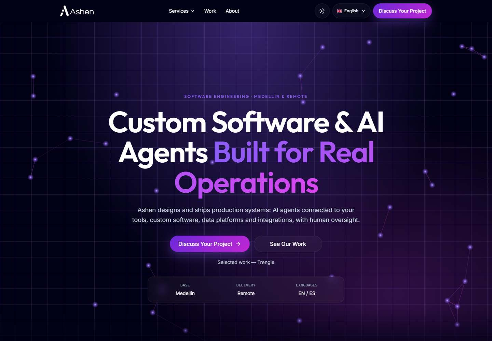

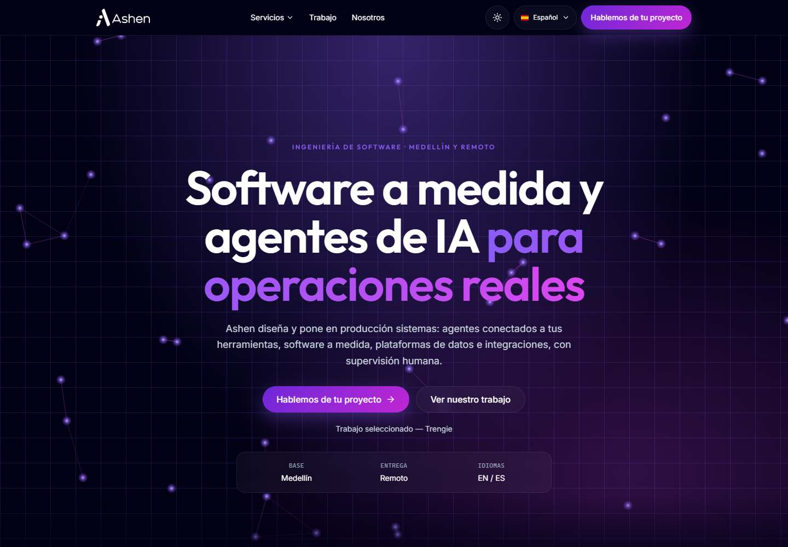

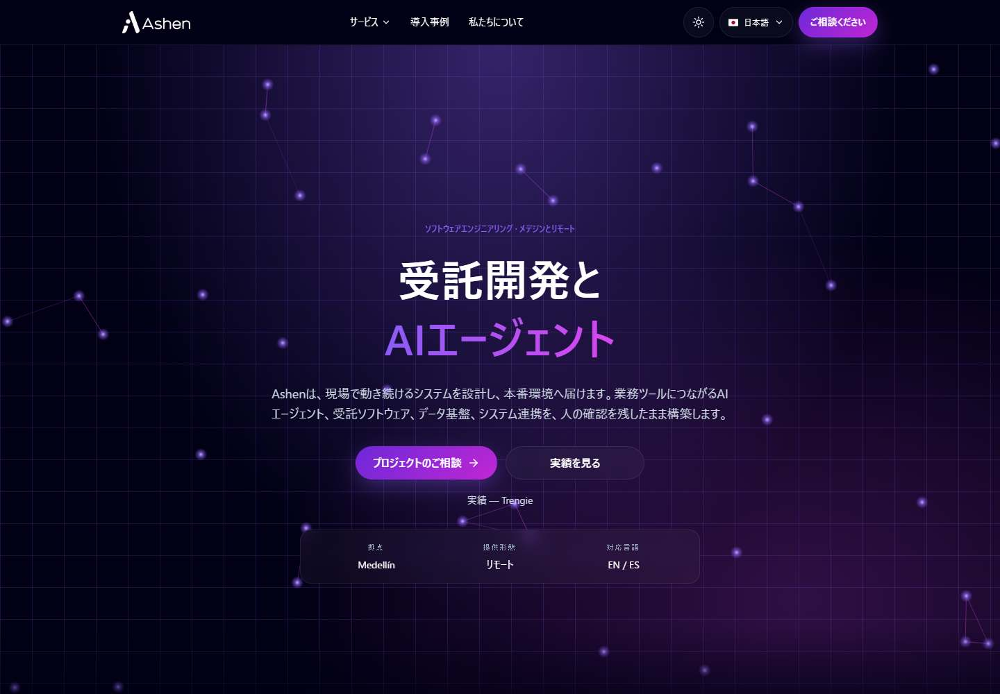

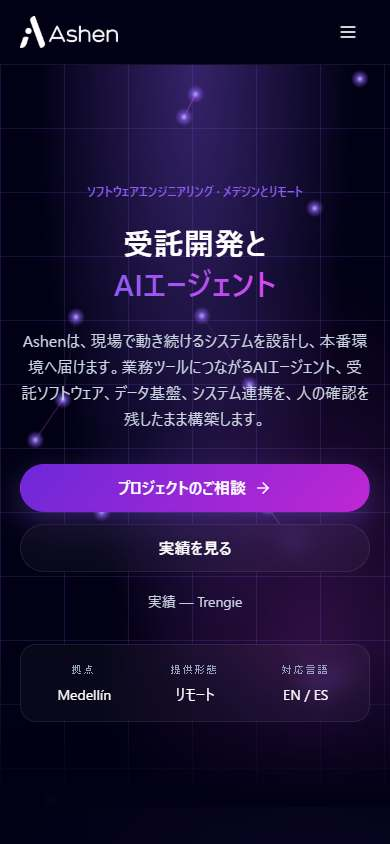

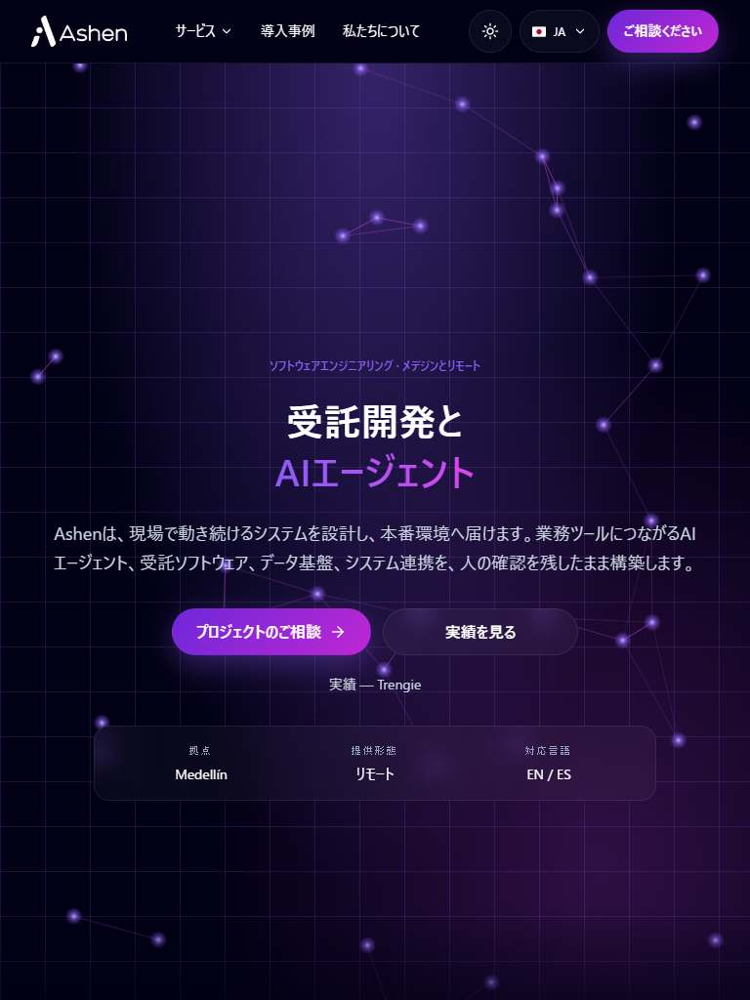

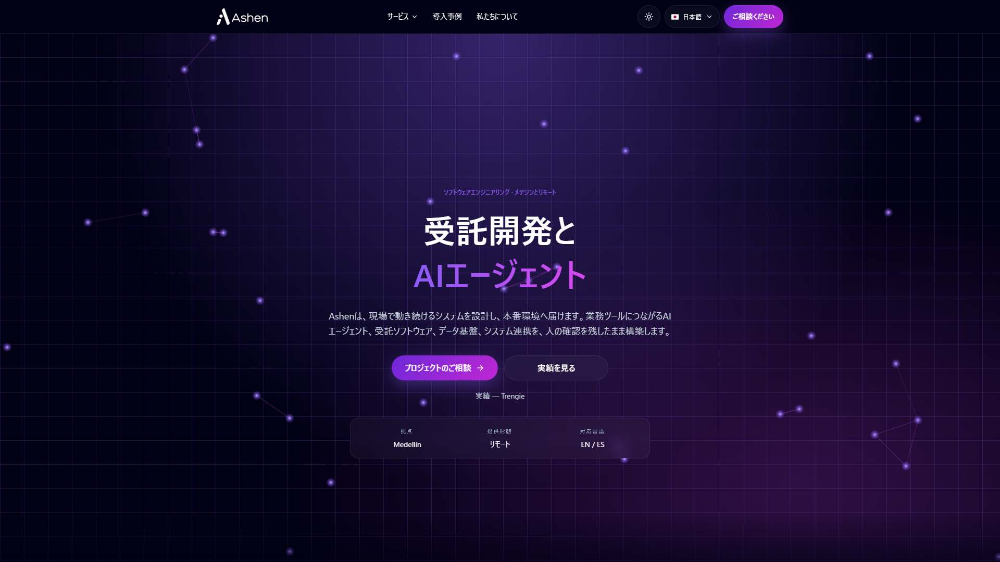

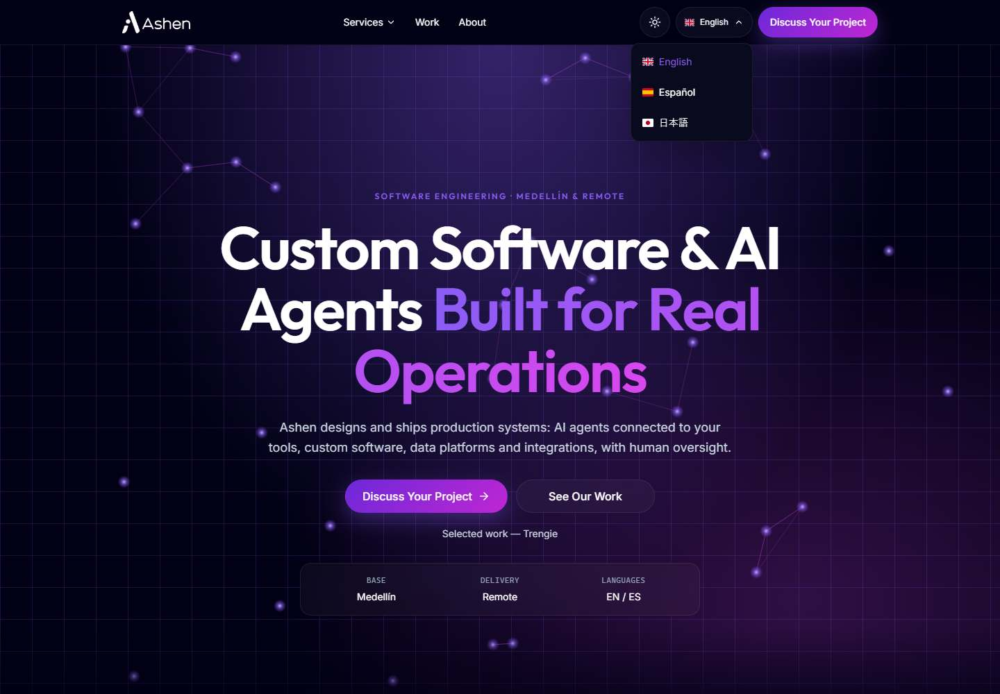

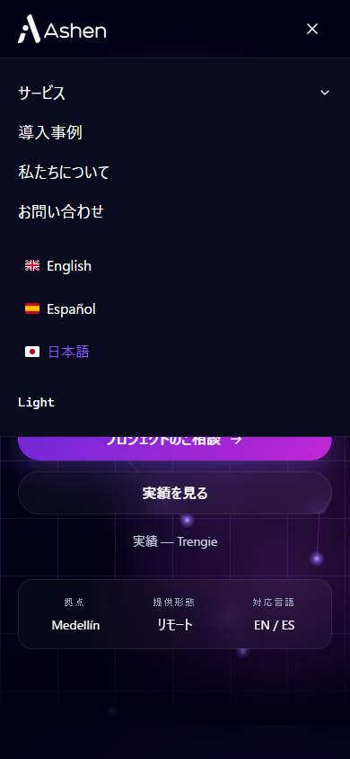

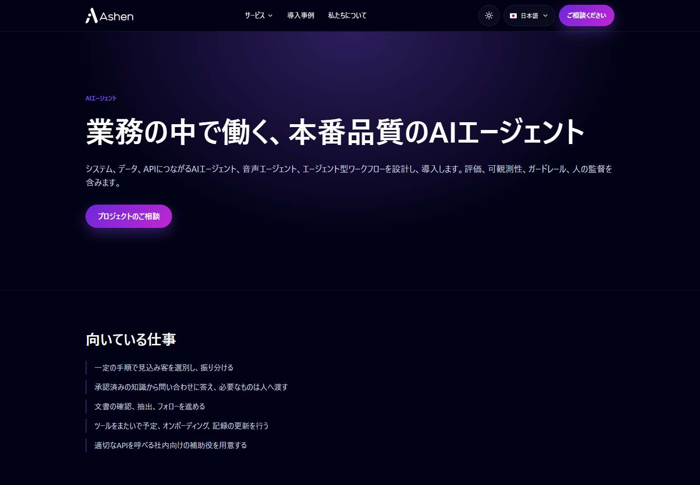

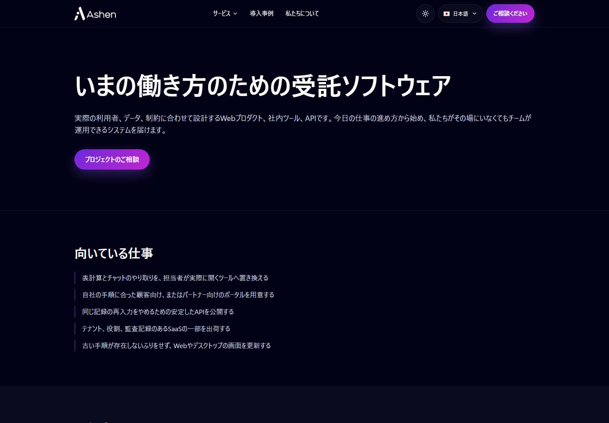

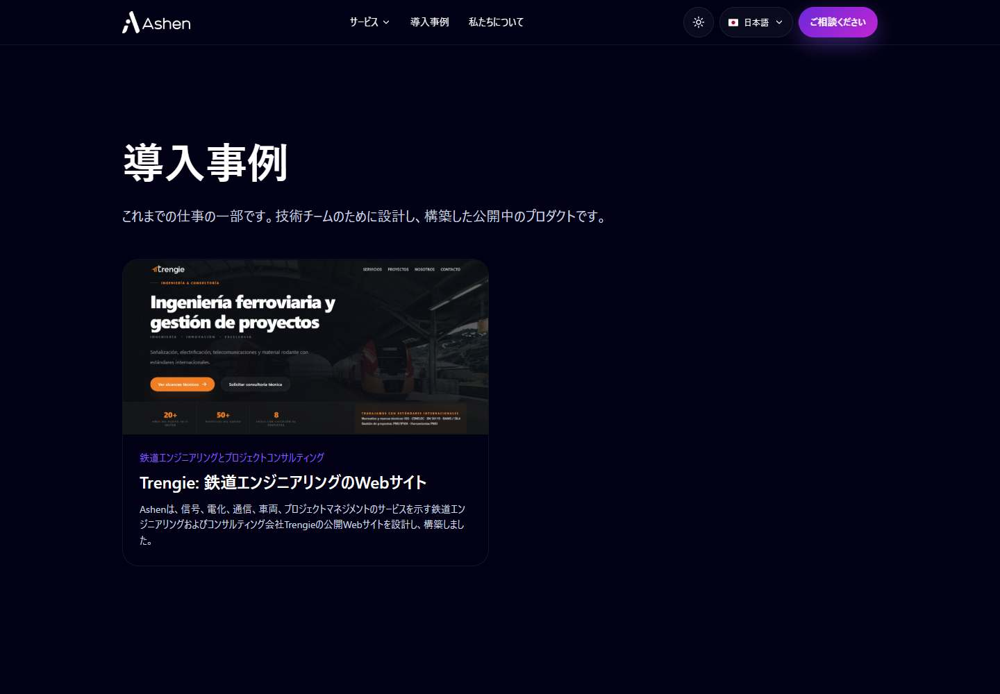

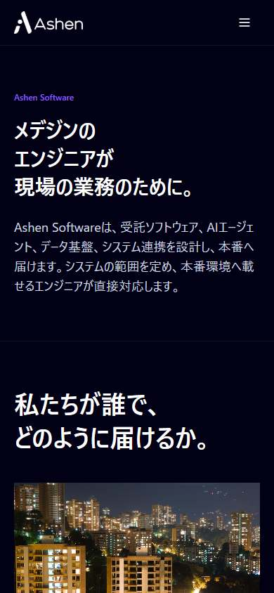

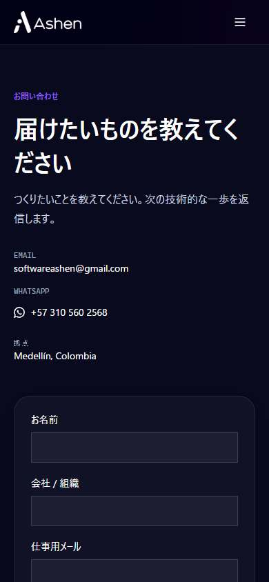

The same folder also has the other checked widths.

## How to test a country

Unit tests call `negotiateLocale` and the real `proxy()` default export. The proxy reads `x-vercel-ip-country`, and the tests set that header.

```text
npm test
```

Covered cases include JP, CO, MX, AR, BR, ES, US, CA, GB, DE, FR, IT, KR, CN, and IN; a Japanese or Spanish browser when the country is missing; an invalid cookie; campaign query strings; explicit URLs; static files; and a single 307 with no loop.

`vercel` is not installed in the environment used for this change, so `vercel dev` was not run. On a Preview deployment, Vercel overwrites `x-vercel-ip-country`, so a request from this machine cannot pretend to be Japan. To check a real country:

1. Open the Preview URL in a private window with no `ashen_locale` cookie.
2. Load `/`. The language follows the country Vercel sees.
3. Set `ashen_locale=en` and load `/` again. It must stay on English even in Japan.
4. Open `/ja/about` and `/ai-agents` directly. Neither URL should be replaced.

Vite preview was used for the visual pass. It does not apply the country redirect.

## Checks that were run

On this branch, after the final headline adjustment:

| Command | Result |
|---|---|
| `npm run type-check` | Passed |
| `npm run lint` | Passed |
| `npm test` | 48 tests passed, 12 files |
| `npm run build` | Passed. Sitemap has 63 URLs. Prerender wrote 63 routes plus `404.html` |
| `npm run seo:check` | Passed for 63 indexable routes |

`npm run seo:indexnow` was not run.

Preview in Chrome, against the built site:

- No horizontal overflow on the Japanese home at 390, 768, 1440, and 1920, or on the Japanese About page.
- The desktop menu lists English, Español, and 日本語. Choosing 日本語 from `/` navigates to `/ja` and sets `ashen_locale=ja`.
- The mobile sheet lists the same three names.
- The Japanese home, About, AI Agents, software, case studies, and contact views render Japanese copy. The delivery-language line stays `EN / ES`.

Client JavaScript after gzip is 152.12 kB, up from 137.89 kB on the previous main, because the Japanese catalog is in the bundle. CSS is 12.65 kB gzip, up from 11.42 kB. `SignalField` is still 1.41 kB gzip. No font file was added.

## Known limits

- Vite does not reproduce Vercel geolocation. Country behavior is tested through `proxy.ts`, not through the Vite server.
- A live Preview hit from Japan, Colombia, and the United States was not possible from this machine, because Vercel assigns the country.
- Helmet emits `hrefLang`. That matches the previous English and Spanish HTML.
- The home console reports React error 419 while the lazy `SignalField` suspense boundary hydrates. The same error appears on the English and Spanish home, and the hero still paints. Inner pages that do not mount `SignalField` do not report it.
- React Router logs `useLayoutEffect` during prerender. That warning already came from `Link` and is now repeated for 63 pages.
- Japanese body copy wraps on character boundaries. That is normal for Japanese. Headlines are broken on phrase boundaries so a word such as エージェント is not split in the hero.
- If a device has none of the Japanese system fonts, glyphs fall through the stack. A webfont was not added, for the CSP and weight reasons above.
- The Japanese pages do not offer Japanese-language sales support, a Japan office, or Japanese client references. Those facts were not invented.
